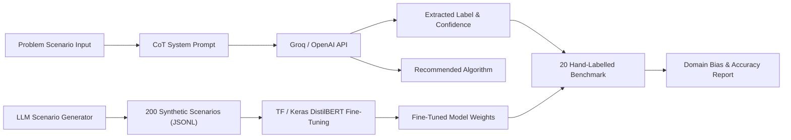

# P2: Learning-Paradigm Identifier (Roll Number 2)

An end-to-end Machine Learning paradigm identifier that classifies complex problem scenarios into **Supervised**, **Unsupervised**, or **Reinforcement Learning**, outputs calibrated confidence distributions, recommends appropriate algorithms, and provides domain-level error & bias analysis.

Built for fast inference with **Groq** (`llama-3.3-70b-versatile` / `llama-3.1-8b-instant`) with optional support for **OpenAI** (`gpt-4o-mini`), **DistilBERT (Keras / TensorFlow)**, and an interactive **Streamlit** dashboard.

---

## 📁 Project Layout

```
p2-learning-paradigm/
├── data/
│   ├── synthetic.jsonl              # 200 balanced synthetic scenarios (U2)
│   ├── handlabelled_20.csv          # 20 hand-crafted benchmark scenarios (Healthcare, Finance, Retail, Manufacturing)
│   └── handlabelled_20_eval.csv     # Model evaluation & prediction records
├── notebooks/
│   └── Train_DistilBERT_Colab.ipynb # One-click Google Colab notebook for GPU training
├── src/
│   ├── cot_classifier.py            # U1: Chain-of-Thought Classifier with confidence extraction
│   ├── generate_data.py             # U2: Synthetic data generator (Groq / OpenAI)
│   ├── train_distilbert.py          # U3 & U4: Keras / TF DistilBERT fine-tuning pipeline
│   └── evaluate.py                  # U5: Per-domain benchmark & bias analysis
├── .streamlit/
│   └── secrets.toml.example         # Template for API keys
├── app.py                           # Full multi-tab Streamlit web application
├── requirements.txt                 # Application dependencies
├── .gitignore                       # Keeps secrets and heavy weights out of Git
└── README.md
```

---

## ⚡ Key Architectural Highlights & Groq Integration

### 1. Chain-of-Thought (CoT) Classifier with Confidence (U1)
- **Step-by-Step Decision Hierarchy:**
  1. *Reinforcement Learning Test:* Does an autonomous agent take sequential actions in an environment to optimize rewards or avoid penalties?
  2. *Supervised Learning Test:* Are there ground-truth output labels or targets for historical training examples?
  3. *Unsupervised Learning Test:* Is the objective to uncover latent clusters, reduce dimensions, or identify anomalies without labeled outcomes?
- **Groq & Confidence Distribution:**
  - The Groq API does not support the `logprobs` parameter (passing `logprobs=True` triggers an HTTP 400 Bad Request error).
  - To provide genuine class probabilities on Groq, `src/cot_classifier.py` incorporates a calibrated verbalized probability distribution requirement (`CONFIDENCE: {"supervised": 0.xx, "unsupervised": 0.xx, "reinforcement": 0.xx}`) which is parsed, validated, and normalized to sum to 1.0.
  - If an OpenAI API key is supplied, token logprobs are read from the completion response.

### 2. Balanced Synthetic Dataset (U2)
- Generated 200 distinct scenarios spanning **3 paradigms** across **5 domains** (*Healthcare, Finance, Retail, Manufacturing, Education*).
- Deduplicated and randomized in `data/synthetic.jsonl`.

### 3. DistilBERT Fine-Tuning in Keras (U3 & U4)
- Uses `TFDistilBertForSequenceClassification` from Hugging Face with TensorFlow/Keras.
- Trained on the 200 synthetic scenarios with Adam optimizer (`lr=2e-5`), Sparse Categorical Crossentropy, and evaluated on the 20 hand-labelled scenarios.
- Ready-to-run Colab notebook provided in `notebooks/Train_DistilBERT_Colab.ipynb` for GPU acceleration.

### 4. 20 Hand-Labelled Edge-Case Benchmark & Bias Analysis (U5)
- Hand-crafted across 4 sectors (~5 scenarios each):
  - **Healthcare:** ICU glucose control (RL), COPD biomarker clustering (Unsupervised), 30-day readmission prediction (Supervised).
  - **Finance:** Algorithmic order execution (RL), high-net-worth client clustering (Unsupervised), credit default rating (Supervised).
  - **Retail:** Autonomous warehouse robot routing (RL), item basket association (Unsupervised), SKU sales forecasting (Supervised).
  - **Manufacturing:** Chemical reactor policy control (RL), baseline vibration anomaly detection (Unsupervised), spindle bearing life (Supervised).
- Detailed domain bias analysis highlights boundary blurring in industrial and financial control tasks.

---

## 📊 Pipeline Flowchart (U4)



---

## 🚀 Quick Start Guide

### 1. Prerequisites
Ensure Python is installed (Python 3.10 - 3.14).

### 2. Clone & Install
```bash
git clone <your-repo-url>
cd p2-learning-paradigm
pip install -r requirements.txt
```

### 3. Configure API Key
Set your Groq API Key via environment variable:
```bash
# On Windows PowerShell:
$env:GROQ_API_KEY="gsk_..."

# On Linux/macOS:
export GROQ_API_KEY="gsk_..."
```
*Alternatively*, you can enter your key directly inside the Streamlit app sidebar, or create `.streamlit/secrets.toml`:
```toml
GROQ_API_KEY = "gsk_..."
```

### 4. Run the Streamlit Application
```bash
streamlit run app.py
```
Open your browser at `http://localhost:8501`.

---

## 🌐 Deploying to Streamlit Community Cloud

1. Push your repository to GitHub:
   ```bash
   git init
   git add .
   git commit -m "feat: complete P2 learning paradigm classifier"
   git branch -M main
   git remote add origin https://github.com/<your-username>/p2-learning-paradigm.git
   git push -u origin main
   ```
2. Navigate to [share.streamlit.io](https://share.streamlit.io).
3. Connect your GitHub account and select this repository.
4. Set Main file path to `app.py` (or `p2-learning-paradigm/app.py`).
5. In **Advanced Settings -> Secrets**, add:
   ```toml
   GROQ_API_KEY = "gsk_..."
   ```
6. Click **Deploy!**

---

## 🎓 Evaluation & Bias Summary (U5 Insights)

- **Domain Discrepancy:** High-dimensional telemetry scenarios (such as manufacturing vibration and ICU waveforms) often present ambiguities between unsupervised anomaly detection vs supervised failure classification.
- **Sequential Feedback vs Static Inference:** Real-world retail and finance applications frequently transition from supervised predictive scoring to sequential reinforcement learning when decision interventions alter future observations.
- **Synthetic Limitations:** Synthetic LLM data tends to use explicit phrasing (e.g., "penalizing delay", "unlabelled clusters"), leading to higher model confidence than real-world messy requirements.

